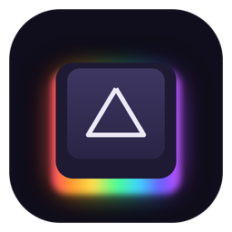
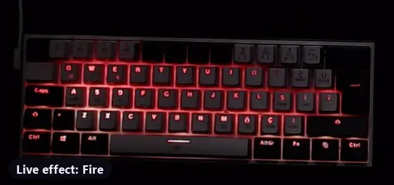
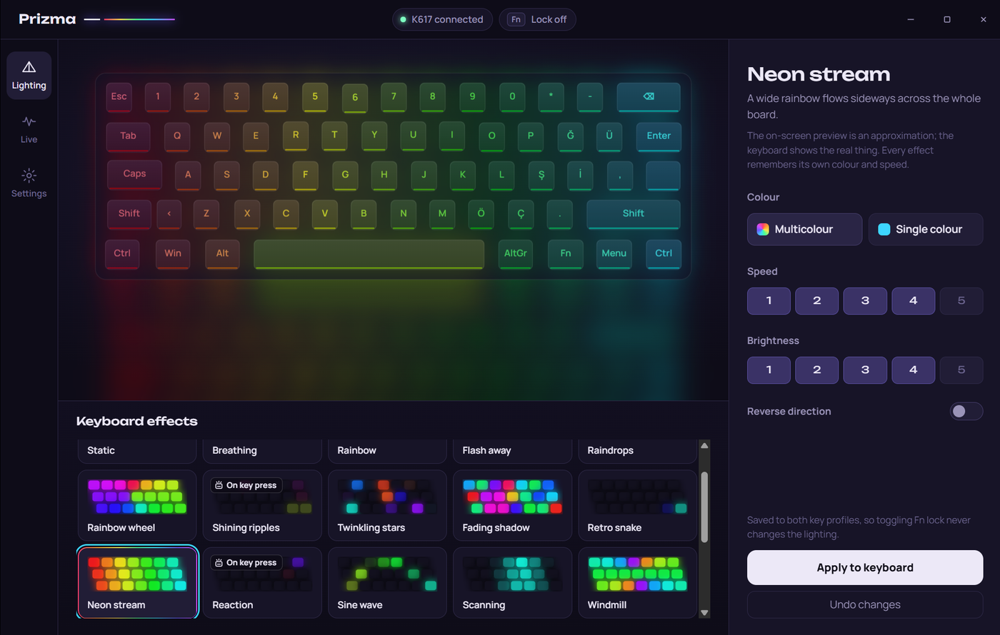
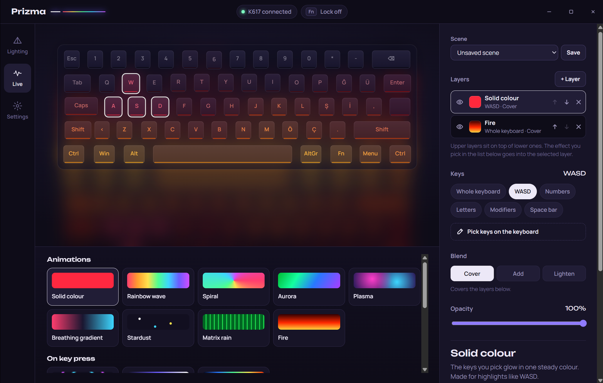

<p align="center">
  
</p>

<h1 align="center">Prizma</h1>

<p align="center">
  <b>Open-source RGB lighting software for the Redragon K617 Fizz keyboard (Windows)</b><br/>
  The keyboard's 20 built-in effects with colour, speed and brightness, plus live per-key effects:<br/>
  music visualizer, screen colour sync, reactive typing and a layer editor.
</p>

<p align="center">
  <a href="https://github.com/Guidin9/prizma/releases/latest"></a>
  
  <a href="LICENSE"></a>
  <a href="README.tr.md"></a>
</p>

<p align="center">
  <br/>
  <sub>The real keyboard running Prizma's live effects: fire, rainbow wave, and an aurora layer with red WASD on top.<br/>
  Filmed with a desk webcam, which washes the LEDs out: in person the colours are brighter and the motion smoother.</sub>
</p>



Prizma is a small, open-source replacement for the official Redragon K617 software. It talks to the
keyboard directly over USB HID, never touches the firmware, and runs in the system tray using about
6 MB of RAM when its window is closed.

## Features

**The keyboard's own effects** (stored on the keyboard, work without Prizma running)

- All 20 built-in effects of the K617 Fizz, under the names the official software uses: Fixed on,
  Respire, Rainbow, Flash away, Raindrops, Rainbow wheel, Ripples shining, Stars twinkle, Shadow
  disappear, Retro snake, Neon stream, Reaction, Sine wave, Retinue scanning, Rotating windmill,
  Colorful waterfall, Blossoming, Rotating storm, Collision and Perfect, plus Off.
- Single colour or multicolour, 5 speed levels, 5 brightness levels, reverse direction.
- Every effect remembers its own colour, speed and brightness, exactly like the keyboard does.
- Saved to both of the keyboard's key profiles, so switching profiles (for example an Fn-lock layer)
  never changes the lighting.
- Previews modelled on camera footage of the real keyboard; effects that only react to key presses
  (Flash away, Ripples shining, Reaction, Perfect) are clearly marked, because they stay dark until
  you type.

**Live effects** (rendered by Prizma at 60 fps and streamed to the keyboard per key)

- Animations: solid colour, rainbow wave (7 directions), spiral, aurora, plasma, breathing
  gradient, stardust, Matrix rain, fire.
- Music visualizer: spectrum, bass pulse and VU meter, driven by whatever your PC is playing
  (WASAPI loopback, no microphone).
- Screen colour sync: each part of the screen lends its colour to the keys below it (Ambilight-style).
- Reactive typing: ripple, trail and a typing heatmap.
- Layer editor: stack effects, limit each layer to some keys (WASD, numbers, letters, modifiers,
  space bar, or any keys you click on the keyboard), blend them (cover, add, lighten), set the
  opacity, and save the result as named scenes.



**Everything else**

- Colour correction for the K617's LEDs: its blue LEDs are much stronger than red and green and the
  keyboard drives them without a gamma curve, so plain screen colours look washed out (warm yellow
  turns white). Prizma corrects for both, tuned by eye on the real keyboard.
- Turkish Q (ISO) and US (ANSI) layouts; effects use where each key physically is.
- English and Turkish interface (follows your Windows language, switchable in Settings).
- Tray icon, optional start with Windows.
- Light on resources: closing the window shuts the interface down completely. Measured on the
  release build: about 6 MB RAM and ~0 % CPU in the tray, even with a live effect running.

## Download and install

1. Download **`Prizma_1.0.0_x64-setup.exe`** (or the `.msi`) from the
   [latest release](https://github.com/Guidin9/prizma/releases/latest).
2. Run it. Windows SmartScreen may warn because the installer is not code-signed: choose
   *More info → Run anyway*.
3. Close the official Redragon software while you use Prizma; both talk to the same USB interface.

Requires Windows 10 or 11 (64-bit). The installer fetches Microsoft Edge WebView2 if it is missing
(it is built into Windows 11).

## Compatibility

| Keyboard | Status |
|---|---|
| Redragon K617 Fizz, wired (USB `258A:0049`, SinoWealth SH68F90A), Turkish Q (ISO) | Tested |
| Redragon K617 Fizz, US ANSI | Layout included from the official software's key map; not tested on hardware yet |
| Other Redragon models | Not supported |

Prizma looks for USB `258A:0049`. Other keyboards that share this ID may answer but are not expected
to work. Reports from other K617 variants are welcome in the issues.

## FAQ

**Is there an alternative to the official Redragon K617 software?**
Yes. Prizma is a free, open-source alternative for the K617 Fizz on Windows. It sets the built-in
effects and adds live effects the official app does not have, such as a music visualizer, screen
colour sync and layered per-key lighting.

**How do I change the RGB lighting of my Redragon K617 Fizz without the official app?**
Install Prizma, pick an effect under *Lighting*, adjust colour, speed and brightness, and press
*Apply to keyboard*. The setting is stored on the keyboard and stays after you close Prizma or
plug the keyboard into another PC.

**Can the K617 Fizz lighting react to music?**
Yes, with Prizma's live effects (*Live → Music*): spectrum, bass pulse or VU meter, following the
sound your PC plays. Live effects run while Prizma is running (also from the tray).

**Does the K617 Fizz support per-key RGB?**
Yes. The keyboard accepts per-key colour frames over USB; Prizma uses them for its live effects and
the layer editor (for example red WASD on top of an animation).

**Why does yellow look white on my K617?**
The keyboard drives its LEDs linearly and its blue LEDs are strong, so the small amount of blue in
warm screen colours comes out several times too bright. Prizma applies gamma and blue-balance correction before
sending colours.

**Some effects stay dark. Is the keyboard broken?**
No. Flash away, Ripples shining, Reaction and Perfect only light up when you press keys.

**Can Prizma damage my keyboard?**
Prizma never writes the firmware. It writes the same settings blocks the official software writes,
reads them back first, and changes only the bytes it needs. Live effects are not saved to the
keyboard at all.

**Does it work on Linux or macOS?**
Not yet. Prizma uses Windows APIs (HID collections, WASAPI loopback, screen capture).

## Privacy

- No network access, no telemetry, no accounts.
- Reactive effects use a passive Windows keyboard hook to know *which key position* was pressed.
  Nothing you type is stored, logged or sent anywhere; the hook only starts when a reactive effect
  is active.
- Music effects read only the loudness of what your PC plays (no microphone). Screen sync reads a
  tiny 96×36 downscaled image of the screen in memory.

## How it works

The K617 Fizz exposes HID feature reports on interface 1: a settings block (effect, speed,
brightness and colour index per effect, for both key profiles), a palette block, and a volatile
382-byte per-key colour frame. The firmware applies a settings write immediately; per-key frames
switch it to host-driven mode until a built-in effect is applied again. Prizma's live engine is
written in Rust (Tauri 2) and renders scenes at 60 fps; the interface is SvelteKit.

## Build from source

```
npm install
npm run tauri dev      # development
npm run tauri build    # installers in src-tauri/target/release/bundle
```

Needs Node.js, Rust (MSVC toolchain), Visual Studio Build Tools and WebView2.

## Roadmap

- Per-game / per-app automatic scenes
- System meters on the keys (CPU, GPU, RAM)
- Key remapping and macros

## Credits

- Protocol research: [fizzctl](https://github.com/ayoubdya/fizzctl) (MIT) and our own analysis of
  the keyboard firmware.
- Flash tooling used during research: [sinowisp](https://github.com/karstx/sinowisp).

Redragon and K617 Fizz are trademarks of their owners. Prizma is an independent project and is not
affiliated with or endorsed by Redragon.

## License

GPL-3.0-or-later. See [LICENSE](LICENSE).
