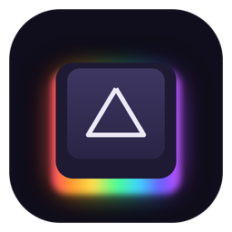
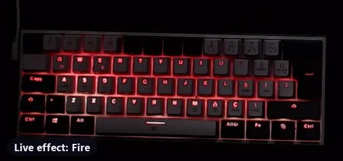
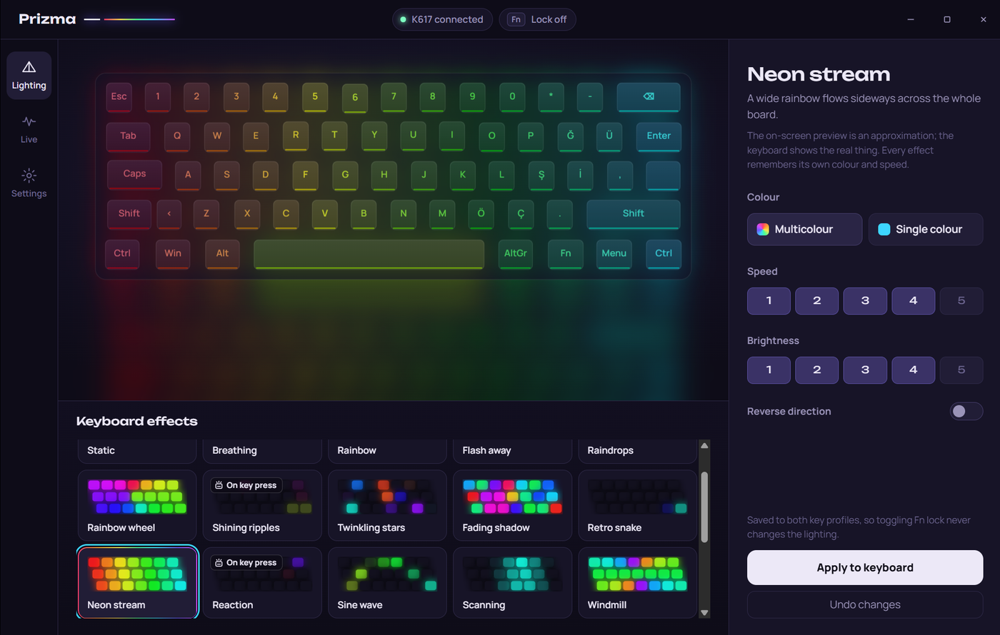
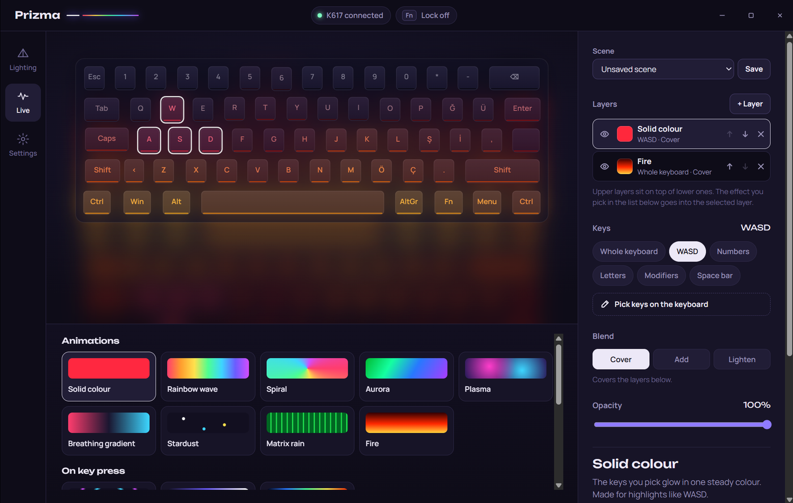

<p align="center">
  
</p>

<h1 align="center">Prizma</h1>

<p align="center">
  <b>Redragon K617 Fizz klavye için açık kaynak RGB ışık programı (Windows)</b><br/>
  Klavyenin 20 hazır efekti renk, hız ve parlaklık ayarıyla; üstüne canlı tuş tuş efektler:<br/>
  müziğe tepki, ekran rengi, yazarken tepki ve katmanlı efekt editörü.
</p>

<p align="center">
  <a href="https://github.com/Guidin9/prizma/releases/latest"></a>
  
  <a href="LICENSE"></a>
  <a href="README.md"></a>
</p>

<p align="center">
  <br/>
  <sub>Gerçek klavyede Prizma'nın canlı efektleri: ateş, gökkuşağı dalgası ve aurora üstünde kırmızı WASD katmanı.<br/>
  Masa üstü web kamerasıyla çekildi; kamera LED'leri soluk gösteriyor. Gerçekte renkler çok daha canlı, hareket daha akıcı.</sub>
</p>



Prizma, Redragon K617'nin resmî yazılımına küçük ve açık kaynak bir alternatif. Klavyeyle doğrudan
USB HID üzerinden konuşur, firmware'e dokunmaz; penceresi kapalıyken sistem tepsisinde yaklaşık
6 MB RAM ile çalışır.

## Özellikler

**Klavyenin kendi efektleri** (klavyede saklanır, Prizma kapalıyken de çalışır)

- K617 Fizz'in 20 hazır efektinin hepsi: Sabit, Nefes, Gökkuşağı, Uçup giden, Yağmur damlaları,
  Gökkuşağı çarkı, Parlayan halkalar, Yıldız pırıltısı, Kaybolan gölge, Retro yılan, Neon akış,
  Tepki, Sinüs dalgası, Tarama, Yel değirmeni, Renkli şelale, Çiçek açma, Dönen fırtına, Çarpışma,
  Mükemmel ve Kapalı. (Resmî yazılımdaki İngilizce adları: Fixed on, Respire, Rainbow, Flash away,
  Raindrops, Rainbow wheel, Ripples shining, Stars twinkle, Shadow disappear, Retro snake, Neon
  stream, Reaction, Sine wave, Retinue scanning, Rotating windmill, Colorful waterfall, Blossoming,
  Rotating storm, Collision, Perfect.)
- Tek renk ya da çok renk, 5 hız, 5 parlaklık kademesi, ters yön.
- Her efekt kendi rengini, hızını ve parlaklığını hatırlar; klavye de böyle saklar.
- Ayar klavyenin iki tuş profiline birden yazılır; profil değişince (ör. Fn kilidi katmanı) ışık
  değişmez.
- Ön izlemeler gerçek klavyenin kamera görüntülerine göre modellendi. Yalnızca tuşa basınca çalışan
  efektler (Uçup giden, Parlayan halkalar, Tepki, Mükemmel) ayrıca işaretli, çünkü yazmazsan
  karanlık kalırlar.

**Canlı efektler** (Prizma 60 fps çizer, klavyeye tuş tuş gönderir; efekte tıklayınca klavyede başlar)

- Animasyonlar: düz renk, gökkuşağı dalgası (7 yön), sarmal, aurora, plazma, nefes gradyanı,
  yıldız tozu, Matrix yağmuru, ateş.
- Müzik: spektrum, bas vuruşu ve ses seviyesi; bilgisayarda ne çalıyorsa ona tepki verir
  (WASAPI loopback, mikrofon kullanılmaz).
- Ekran rengi: ekranın her bölgesinin rengi altındaki tuşlara geçer (Ambilight benzeri).
- Yazarken tepki: dalga, iz ve ısı haritası.
- Katmanlı editör: efektleri üst üste koy, her katmanı belli tuşlarla sınırla (WASD, rakamlar,
  harfler, kenar tuşları, boşluk ya da klavyede tıklayarak seçtiğin tuşlar), karıştırma modu
  (üstüne, parlat, aydınlat) ve opaklık seç, sonucu isimli sahne olarak kaydet.



**Diğerleri**

- K617'nin LED'lerine göre renk düzeltmesi: mavi LED'ler kırmızı ve yeşilden çok daha güçlü ve
  klavye LED'leri gama eğrisi olmadan sürüyor; düz ekran renkleri soluk görünür (sıcak sarı beyaza
  döner). Prizma ikisini de düzeltir; değerler gerçek klavyede gözle ayarlandı.
- Türkçe Q (ISO) ve ABD (ANSI) dizilim; efektler her tuşun gerçek yerine göre hesaplanır.
- Türkçe ve İngilizce arayüz (Windows diline uyar, Ayarlar'dan değiştirilebilir).
- Tepsi simgesi, isteğe bağlı Windows ile başlama.
- Kaynak dostu: pencereyi kapatınca arayüz tamamen kapanır. Release sürümünde ölçüldü: tepsideyken,
  canlı efekt çalışırken bile ~6 MB RAM ve ~%0 CPU.

## İndirme ve kurulum

1. [Son sürümden](https://github.com/Guidin9/prizma/releases/latest)
   **`Prizma_<sürüm>_x64-setup.exe`** (ya da `.msi`) dosyasını indir.
2. Çalıştır. Kurulum dosyası imzalı olmadığı için Windows SmartScreen uyarı verebilir:
   *Ek bilgi → Yine de çalıştır*.
3. Prizma'yı kullanırken resmî Redragon yazılımını kapat; ikisi aynı USB arayüzünü kullanır.

Windows 10 ya da 11 (64 bit) gerekir. WebView2 eksikse kurulum onu indirir (Windows 11'de hazır gelir).

## Uyumluluk

| Klavye | Durum |
|---|---|
| Redragon K617 Fizz, kablolu (USB `258A:0049`, SinoWealth SH68F90A), Türkçe Q (ISO) | Denendi |
| Redragon K617 Fizz, ABD ANSI | Dizilim resmî yazılımın tuş haritasından alındı; donanımda henüz denenmedi |
| Diğer Redragon modelleri | Desteklenmiyor |

## Sık sorulanlar

**Redragon K617'nin resmî yazılımı yerine kullanılabilecek bir program var mı?**
Evet. Prizma, Windows'ta K617 Fizz için ücretsiz ve açık kaynak bir alternatif. Hazır efektleri
ayarlar; resmî uygulamada olmayan müziğe tepki, ekran rengi ve katmanlı tuş tuş ışık gibi canlı
efektler ekler.

**K617 Fizz'in RGB ışığını resmî uygulama olmadan nasıl değiştiririm?**
Prizma'yı kur, *Işık* bölümünde bir efekt seç, renk, hız ve parlaklığı ayarla, *Klavyeye uygula*'ya
bas. Ayar klavyede saklanır; Prizma'yı kapatınca ya da klavyeyi başka bilgisayara takınca da kalır.

**K617 Fizz'in ışığı müziğe tepki verebilir mi?**
Evet, Prizma'nın canlı efektleriyle (*Canlı → Müzik*): spektrum, bas vuruşu ya da ses seviyesi.
Canlı efektler Prizma çalışırken (tepside de) sürer.

**K617'de sarı neden beyaz görünüyor?**
Klavye LED'leri doğrusal sürüyor ve mavisi güçlü; sıcak renklerdeki az miktardaki mavi birkaç kat
fazla parlak çıkıyor. Prizma renkleri göndermeden önce gama ve mavi dengesiyle düzeltir.

**Bazı efektler karanlık kalıyor, klavye mi bozuk?**
Hayır. Uçup giden, Parlayan halkalar, Tepki ve Mükemmel yalnızca tuşa basınca yanar.

**Prizma klavyeme zarar verebilir mi?**
Prizma firmware'e hiç yazmaz. Resmî yazılımın yazdığı ayar bloklarını yazar, önce okur ve yalnızca
gereken baytları değiştirir. Canlı efektler klavyeye hiç kaydedilmez.

## Gizlilik

- İnternet bağlantısı yok, telemetri yok, hesap yok.
- Tuşa tepki veren efektler hangi *tuş konumuna* basıldığını bilmek için pasif bir Windows klavye
  kancası kullanır. Yazdığın hiçbir şey saklanmaz, kaydedilmez, bir yere gönderilmez; kanca yalnızca
  böyle bir efekt açılınca başlar.
- Müzik efektleri yalnızca bilgisayarın çaldığı sesin şiddetini okur (mikrofon yok). Ekran rengi,
  ekranın bellekte 96×36'lık küçültülmüş bir görüntüsünü okur.

## Kaynaktan derleme

```
npm install
npm run tauri dev      # geliştirme
npm run tauri build    # kurulum dosyaları: src-tauri/target/release/bundle
```

Gerekenler: Node.js, Rust (MSVC), Visual Studio Build Tools, WebView2.

## Sırada

- Oyuna / uygulamaya göre otomatik sahne
- Tuşlarda sistem göstergeleri (CPU, GPU, RAM)
- Tuş atama ve makro

## Teşekkür

- Protokol araştırması: [fizzctl](https://github.com/ayoubdya/fizzctl) (MIT) ve klavye
  firmware'inin kendi analizimiz.
- Araştırmada kullanılan flaş aracı: [sinowisp](https://github.com/karstx/sinowisp).

Redragon ve K617 Fizz, sahiplerinin markalarıdır. Prizma bağımsız bir projedir; Redragon ile
bağlantılı değildir ve onun tarafından onaylanmamıştır.

## Lisans

GPL-3.0-or-later. Ayrıntılar `LICENSE` dosyasında.
